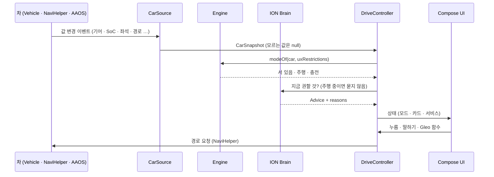
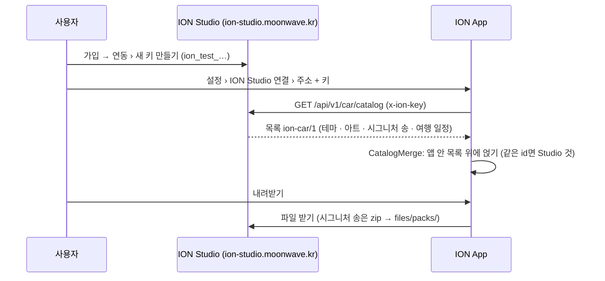

# 앱 구조

ION 앱의 패키지 구성, 차 신호가 화면이 되기까지의 흐름, 지키는 규칙과 테스트를 적었어요.

[← README](../README.md) · [화면 설명서](SCREENS.md) · 기획서 [개발 계획](https://prd.moonwave.kr/dev) · [데이터 사전](https://prd.moonwave.kr/data) · [ION Brain](https://prd.moonwave.kr/brain) · [ION Studio](https://ion-studio.moonwave.kr)

---

## 1. 흐름 한눈에



1. **차 신호는 한 모양으로**: `CarSource`가 Vehicle SDK · NaviHelper SDK · AAOS 값을 `CarSnapshot` 하나로 모아요. 차가 아닌 기기에서는 `NoCarSource`가 빈 값을 줘요. 어느 쪽이든 **모르는 값은 `null`** 이고, 화면은 그 값을 "—"나 "아직 몰라요"로 그려요.
2. **모드는 차가 정해요**: `Engine.modeOf`가 기어 · 충전구 · 주행 규제로 세 가지 모드를 고르고, 사용자는 모드를 고르지 않아요.
3. **ION Brain은 규칙이에요**: 권하기 · 일정 · 충전 계획 · 기억 · 대화는 순수 함수예요. 같은 값을 넣으면 같은 답이 나와서 단위 테스트로 지킬 수 있어요. LLM · 벡터 DB는 이 APK에 없어요(하이엔드 제안은 기획서 [ION Brain](https://prd.moonwave.kr/brain)).
4. **한 곳에서 모아요**: `DriveController`가 차 값 · 모드 · 권하기 · 서비스 상태 · 음성 · Gleo를 모아 화면 상태를 만들어요.

기획서의 같은 그림: [질문 한 번이 지나가는 길](https://prd.moonwave.kr/brain#brain-path) · [하이엔드 구현 단계](https://prd.moonwave.kr/dev#hb-steps)

## 2. 패키지

`app/src/main/java/app/roadmemory/car/`

| 패키지 | 맡은 일 | 주요 파일 |
|---|---|---|
| (루트) | 앱 시작 · 모든 상태를 모으는 곳 | `MainActivity` · `DriveController` |
| `data/` | 차 신호 읽기 · 기기 안 저장 · 시연 데이터 | `CarSource` · `PleosCarSource` · `NoCarSource` · `AaosReader` · `UxRestrictions` · `TripStore`(SQLite) · `TripMeter` · `TripRecording` · `Telltales` · `TirePressure` · `CheckupReading` · `TrackPlayer` · `Weather` · `DemoTrips` · `DemoCheckup` · `DemoUser` |
| `engine/` | 모드 · 환경 · 취향 판단 | `Engine`(세 가지 모드) · `EnvEngine`(날씨 신호 → 화면 톤) · `TasteEngine` |
| `brain/` | ION Brain 규칙 | `Advisor`(권하기 + 이유) · `Quiet`(거절 세기 · 쉬기) · `Agenda`(캘린더) · `TripPlan`(충전 계획) · `ChargeLog`(충전 속도) · `Memories`(그날의 기억) · `Shelves`(서비스별 고르기) · `Conversation`(인사 · 칩 · 명령) · `Context`(한 턴 기억) · `StudioAnswers`(기록 질문) · `HeardLog`(들은 말) · `Korean`(조사) |
| `ontology/` | ION-Link 그래프 | `Ontology`(개념 상태 · 기능 판정) · `OntologyAnswers` |
| `pack/` | 시그니처 송 | `MomentEngine`(순간 알아차리기) · `MomentText` · `PackPlayer`(오디오 포커스) · `PackStore` |
| `studio/` | ION Studio · 마이현대 서비스 | `StudioCatalog` · `StudioLibrary`(내려받기 · 적용 · 지우기) · `StudioLink`(선택 연결) · `Slideshow` · `ChargeShow` · `TripDone` |
| `navi/` | 내비 경로 요청 | `NaviLink`(`requestRoute` · 경유지) |
| `voice/` | 말하기 | `PleosVoice`(SpeechToText) · `VoiceInput` · `VoiceCommands` |
| `gleo/` | Gleo Interface | `GleoBridge`(함수 처리 · 7초 안 응답) · `GleoReceiver`(service 함수) |
| `ion/` | ION 대화창의 답 순서 | `IonAssistant` |
| `family/` | 가족 위치 틀 | `FamilyLink` · `DemoFamily` |
| `ui/` | Compose 화면 | `Screens` · `IonHome` · `IonDisplay` · `Hero` · `Services` · `ServiceWorkflow` · `ChargeSlideshow` · `CheckupUi` · `CalendarUi` · `MusicUi` · `ArtUi` · `TripDetailUi` · `LinkUi` · `Theme` · `ThemeSet` · `Tone` |

## 2-1. ION Studio 연동 (선택)



- 담당: `studio/StudioLink`(받기 · 상태) · `studio/StudioCatalog`(합치기) · `studio/StudioLibrary`(내려받기 · 적용) · `ui/LinkUi`(설정 화면).
- 보내는 것은 **키뿐**이에요. 차의 값이나 위치는 보내지 않아요. 잇지 않으면 네트워크를 쓰지 않아요.
- 시그니처 송 팩 형식은 `ion-pack/1`, 디스플레이 테마는 `ion-theme/1`(카드 세트 14장 포함)이에요. 키를 실은 `/api/v1/` 요청은 사이트의 PIN 문을 지나가요.
- 본래 길은 블루링크 스토어 → 차이고, 이 연결은 시연을 위한 길이에요. 기획서 [ION Studio와 ION App 잇기](https://prd.moonwave.kr/services#ion-connect) · [연동 · API 키](https://prd.moonwave.kr/ion-studio#ion-api) · [스토어 통합](https://prd.moonwave.kr/ion-studio#ion-store).

`app/src/debug/`에는 **디버그 빌드에만 있는 진단 도구**가 있어요(읽기 API 전체 재기 · 내비 경로 · 도착 흉내 · 시그니처 송 적용 · 가족 위치 시험). 제출용 release APK에는 들어가지 않아요.

## 3. Pleos Connect 연동

### Vehicle SDK 2.3.2
- 구독해서 쓰는 값: 배터리 SoC · 배터리 에너지 · 주행 가능 거리 · 충전구 · 충전 상태 · 기어 · 좌석 착좌 · 안전벨트 · 문 · 트렁크 · 후드 · 와이퍼 · 등 · 공조 온도. 읽기 전에 도메인마다 지원 여부(`checkXxxCapabilities`)를 먼저 묻고, 지원한다고 답한 구역만 읽고 구독해요.
- 읽기 API 104개를 에뮬레이터에서 모두 불러 보고, 값이 오는 것만 화면에 썼어요. 결과는 기획서 [데이터 사전](https://prd.moonwave.kr/data)에 있고, 선언한 권한은 [이 앱이 선언할 권한](https://prd.moonwave.kr/data#permissions)이에요.
- 에뮬레이터에서 알게 된 것:
  - 좌석 착좌 Boolean이 반대로 와서(Occupied → `false`) 앱이 뒤집어 써요(`PleosCarSource`). 실제 차에서도 같은지는 확인이 필요해요.
  - 이 차량은 트립 거리를 주지 않아서 **이번 여행 거리는 오도미터의 차이**로 재요(`TripMeter`).
  - 경고등 · 바퀴별 공기압은 앱 마켓 승인이 필요한 권한(`PRIVATE_CAR_SAFETY` 등)이라 선언하지도 부르지도 않아요. 점검 화면은 서비스센터 기록 값으로 보여 주고, `PermissionPolicyTest`가 이 약속을 지켜요.

### NaviHelper SDK 3.0.5
- `requestRoute` · `requestRouteWithWaypoints`로 마이 트립 정류장 · 약속 장소 · 저장한 목적지로 안내해요.
- `onDestinationInfo`에서 `requestTrip`을 불러 **도착 예상 배터리**를 받아요.
- `onWayPointArrived` · `onDestinationArrived`로 마이 트립의 진행을 옮겨요(위치를 읽지 않아요).
- 내비 앱은 배터리가 모자라면 스스로 충전소 경유 경로를 만들어요. ION은 이와 겹치지 않게 **카드로 한 번 묻기**만 해요.

### SpeechToText SDK 3.3.1
- 온디바이스 ko-KR 인식 → `VoiceCommands`의 낱말 규칙 → Gleo 함수와 같은 일로 이어요. 말뜻을 이해하는 모델이 아니라 규칙이에요.

### Gleo Interface
`app/src/main/assets/schema.json`의 함수 3개. 에뮬레이터에서 Gleo AI가 설치 때 이 파일을 읽는 것을 확인했어요.

| 함수 | component | 하는 일 |
|---|---|---|
| `SHOW_ROAD_MEMORY` | activity | 가는 곳(또는 말한 곳)으로 저장된 여행과 그때 곡을 보여 줘요. 없으면 없다고 말해요 |
| `OPEN_CHARGING_LOUNGE` | activity | 충전 화면을 열어요 |
| `SUGGEST_CHARGING_STOP` | service | 내비의 도착 예상 배터리로 충전이 필요한지 말해요. 경로는 바꾸지 않아요 |

응답은 7초 안에 `ai.pleos.playground.intent.action.APP_ACTION_RESPONSE` 브로드캐스트로 보내요(`status` = success · asking · fail). 주고받는 데이터는 기획서 [Gleo 음성](https://prd.moonwave.kr/data#gleo-voice)에 있어요.

### AAOS
- `CarUxRestrictions`(`UxRestrictions`): 플랫폼이 "제한 필요"라고 하면 기어보다 먼저 주행 모드로 가고, `LIMIT_STRING_LENGTH`가 켜지면 카드 · 답을 그 길이에서 끊어요. 플래그는 지역마다 달라서 앱이 정하지 않고 플랫폼 값을 따라요. 에뮬레이터 확인: 기어 D에서 영상 · 설정 제한, 글 120자.
- 외기온 · 충전구는 AAOS 속성으로 읽어요(`AaosReader`).

## 4. 지키는 규칙

| 규칙 | 어떻게 |
|---|---|
| 차가 주지 않는 값은 그리지 않아요 | `CarSnapshot`의 모르는 값은 `null`, 화면은 "—" · "아직 몰라요". 차가 아니면 `NoCarSource` |
| 주행 중에는 카드 한 장 | 주행 모드에서는 다른 화면이 열리지 않고(`usesWorkspace`), 입력이 없고, 권하지 않아요 |
| 주행 중에는 짧게 | 답은 첫 토막만(`Brevity.forDriving`), 화면 링크 칩 없음 |
| 이유를 밝혀요 | 권할 때마다 쓴 값에서만 `reasons`를 만들어요 |
| 덜 귀찮게 | 같은 종류를 두 번 거절하면 7일 쉬어요(`Quiet`) |
| 기기 안에서 끝나요 | 여행 기록은 SQLite, 들은 말은 끌 수 있고 이 기기에만. 위치를 계속 읽지 않아요 |
| 안전이 먼저 | 시그니처 송 목소리는 안전 카드 · 카드 읽기가 끝나기를 기다리고, 주행 중에는 6초에서 끊어요. 안전 소리는 팩이 대신하지 않아요 |
| 움직임을 줄일 수 있어요 | 기기에서 애니메이션을 끄면 인트로 · ION 구 · 크로스페이드가 멈춰요 |

이 규칙들의 근거는 기획서 [공식 세 원칙과 이 앱](https://prd.moonwave.kr/ux#principles) · [주행 중 안전](https://prd.moonwave.kr/highend#driving-safety) · [데이터와 사생활](https://prd.moonwave.kr/highend#privacy) · [Lessons Learned › ION은 이렇게 답했어요](https://prd.moonwave.kr/lessons#ll-ion)에 있어요.

## 5. ION-Link (APK 안 그래프)

- `assets/ontology.json`: 출처 · 권한 · 읽기 API · 개념 · ION의 기능 30개와 그 관계(노드 262 · 관계 423). 에뮬레이터 실측 로그로 만들었어요.
- `Ontology`가 **개념의 상태**(읽혀요 · 계산해서 써요 · 추정해요 · 권한이 막아요 · 이 차량에 없어요 · 폰에 있어요)와 **기능 판정**(● · ◐ · ○)을 규칙으로 계산해요. 판정이 파일에 적혀 있지 않아서, 다시 재서 그래프를 만들면 답이 바뀌어요.
- 대화창에서 "외기온을 쓰는 기능은?" · "충전 경유 제안에는 뭐가 필요해?" · "경고등 해설은 왜 못 해?"에 답해요.
- 시그니처 송의 **순간**도 이 그래프의 노드예요. 쓰는 값이 ●일 때만 소리를 낼 수 있어요. ION Studio도 같은 순간 목록을 읽어서, 창작자는 차가 실제로 알아차릴 수 있는 순간에만 목소리를 붙여요.
- 하이엔드에서 이 그래프가 어떻게 커지는지는 기획서 [등록 → 임베딩 → ION-Link](https://prd.moonwave.kr/brain#ion-link) · [아는 쪽: ION-Link](https://prd.moonwave.kr/brain#brain-ontology)에 있어요.

## 6. 저장

| 무엇 | 어디 | 비고 |
|---|---|---|
| 여행 기록 | SQLite(`TripStore`) | 처음 열면 시연 여행 12건을 한 번 넣어요. 모두 지우면 다시 넣지 않아요 |
| 서비스 상태(내려받음 · 적용) | `files/studio/` + SharedPreferences | 결제 없음 |
| 충전 기록 · 거절 세기 · 마지막 화면 | SharedPreferences | |
| 들은 말 | 앱 폴더(500줄) | 설정에서 끄기 · 내보내기 · 지우기 |

## 7. 테스트

```bash
./gradlew testDebugUnitTest
```

386개(테스트 클래스 52개). 385개 통과, 1개는 기획 저장소에만 있는 약속 파일을 확인하는 것이라 이 저장소에서는 건너뛰어요.

| 묶음 | 지키는 것 |
|---|---|
| `WorkspaceTest` · `UxRulesTest` | 주행 중 화면이 열리지 않고, 주행 규제 · 글 길이 제한을 따르는지 |
| `QnaBankTest` · `QnaExpectationsTest` · `QnaReportTest` | 사람 말투 질문 261개를 실제 답변 순서로 돌려 답이 맞는지 |
| `ConversationTest` · `ContextTest` · `CompareAndHeardTest` | 인사 · 칩 · 명령 · 한 턴 기억 · 비교 문장 |
| `AgendaTest` · `ShelvesTest` · `TripArrivalTest` | 캘린더 · 서비스 고르기 · 내비 도착으로 정류장 넘기기 |
| `CheckupReadingTest` · `DemoCheckupTest` | 읽은 값을 먼저 쓰고, 기록과 경고가 서로 모순되지 않는지 |
| `ThemeSetTest` · `AlbumPhotosTest` | 테마 카드 세트 · 앨범 사진(EXIF 없음 · 개인 이름 없음) |
| `OntologyTest` · `IonOrbTest` · `KoreanGwaTest` | ION-Link 판정 · ION 구 계산 · 조사 |
| `NoDemoTextOnScreenTest` · `NoPlanningSpeakOnScreenTest` | 개발자 말투가 화면 글에 들어오지 않게 |

## 8. 빌드

| 항목 | 값 |
|---|---|
| Gradle | 래퍼 포함(`./gradlew`) |
| Kotlin · AGP | 2.0.0 · 8.8.2 |
| Compose BOM | 2024.04.01 |
| SDK | minSdk 28 · targetSdk 35 · compileSdk 35 |
| JDK | 17 이상(21 확인) |
| Pleos 저장소 | `https://nexus-playground.pleos.ai/repository/maven-releases/` (계정 필요 없음) |
| release 서명 | `keystore.properties` · `release.keystore`가 있을 때만. 인증서에 이름 · 연락처가 없어요(`CN=Road Memory`) |
