# 화면 설명서

ION의 화면마다 **무엇을 보여 주고, 그 값이 어디서 오는지** 적었어요. 그림은 모두 Pleos Connect 에뮬레이터 2.1.0(2560 × 1440)에서 찍은 실제 화면이에요.

[← README](../README.md) · [앱 구조](ARCHITECTURE.md) · 기획서 [ION App 실제 화면](https://prd.moonwave.kr/ion-app#app-screens) · [시안과 실제 앱 화면](https://prd.moonwave.kr/ux#mock-real) · [ION Studio](https://ion-studio.moonwave.kr)

**값의 출처 표시**: 🚗 차(Pleos SDK · AAOS)가 준 값 · 📱 이 기기에서 잰 값이나 저장한 값 · 🎬 APK 안 시연 데이터

---

## 1. 켜면 보이는 것

**인트로 막**: 흰 바탕에서 ION 구(회색에서 검정까지의 도트)가 가운데부터 켜지고 → "ION" → 차와 이어지면 **"안녕하세요!"** → 고리처럼 열려요. 단계마다 450ms예요. 이어지는 동안 "연결 중" 화면을 대신하고(최대 6초), 누르면 건너뛰어요.
- **주행 중에 켜면 건너뛰어요**(주행 중에 움직이는 화면을 띄우지 않아요).
- 기기에서 애니메이션을 끄면 움직임 없이 보여 줘요.

**작업 화면**: 서 있을 때 앱 창은 **황금비 1 : 1.618**로 나뉘어요.
- **왼쪽 = ION 칸**: ION 디스플레이 → 말풍선 → "이렇게 말해 보세요" 칩 → **말하기 · 홈** 단추. 구성은 Pleos 가이드 Gleo AI의 Bubble · Chips · 상태 표시를 따라요.
- **오른쪽 = 마지막으로 보던 화면**: 처음이거나 "홈"을 누르면 ION 홈이에요. 앱을 다시 켜도 그 화면부터 열려요.

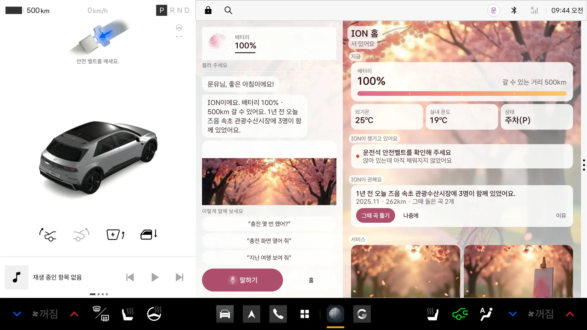

> 기획서에서: [공식 세 원칙과 이 앱](https://prd.moonwave.kr/ux#principles) · [세 가지 모드](https://prd.moonwave.kr/features#modes) · 장면 [A · 처음 이어지는 날](https://prd.moonwave.kr/scenarios#scenario-a)

## 2. ION 홈

| 낮 | 밤 |
|---|---|
| 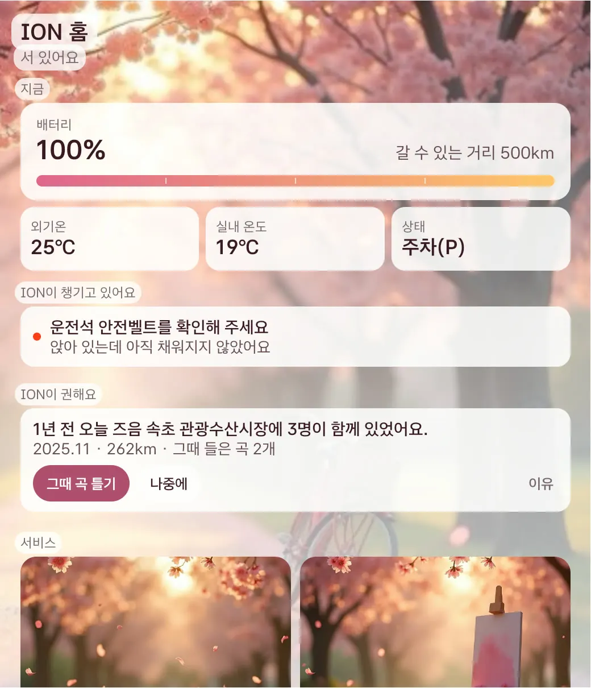 | 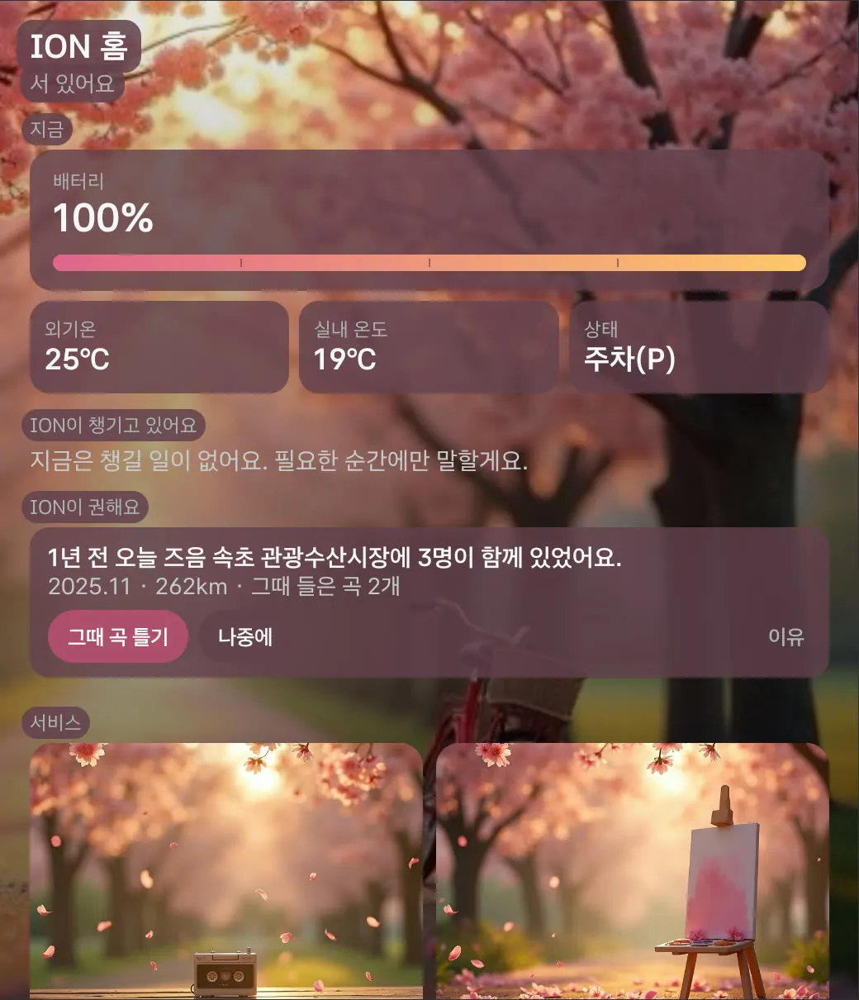 |

| 칸 | 내용 | 출처 |
|---|---|---|
| 지금 | 배터리 % · 갈 수 있는 거리(계기판과 같은 값) · 외기온 · 실내 온도 · 기어 | 🚗 |
| ION이 챙기고 있어요 | 안전벨트 · 경로와 도착 배터리 · 충전 · 쉬어 가기 · 추운 날 · 열려 있는 문 | 🚗 |
| ION이 권해요 | 한 번에 한 장. 다음 정류장 · 충전 계획 · 그날의 기억 · 곡 · 약속 · 테마. **이유** 단추로 왜 권하는지 봐요 | 🚗 📱 🎬 |
| 서비스 | 서비스 여덟 가지와 지금 상태(적용 중 · 내려받음 · 담은 일정) | 📱 🎬 |
| 화면 | 충전 · 가족 · 자리 · 점검 · 여행 기록 · ION이 닿는 데이터 · 설정 | |

- 권하는 카드에서 "나중에"를 누르면 그 종류를 덜 권하고, 같은 종류를 두 번 거절하면 7일 동안 쉬어요.
- 테마에 카드 세트가 있으면 홈의 카드 열네 장(서비스 여덟 + 화면 여섯)이 그 테마의 그림을 입어요.

> 기획서에서: [ION 한눈에](https://prd.moonwave.kr/ion-app#h-glance) · [기본 기능 여섯 가지](https://prd.moonwave.kr/features#six) · [ION이 하는 일 · 하지 않는 일](https://prd.moonwave.kr/brain#ion-does) · 장면 [I · 1년 전 오늘](https://prd.moonwave.kr/scenarios#scenario-i)

| 서비스 앞 넷(ION Studio) | 서비스 뒤 넷(마이현대) |
|---|---|
| 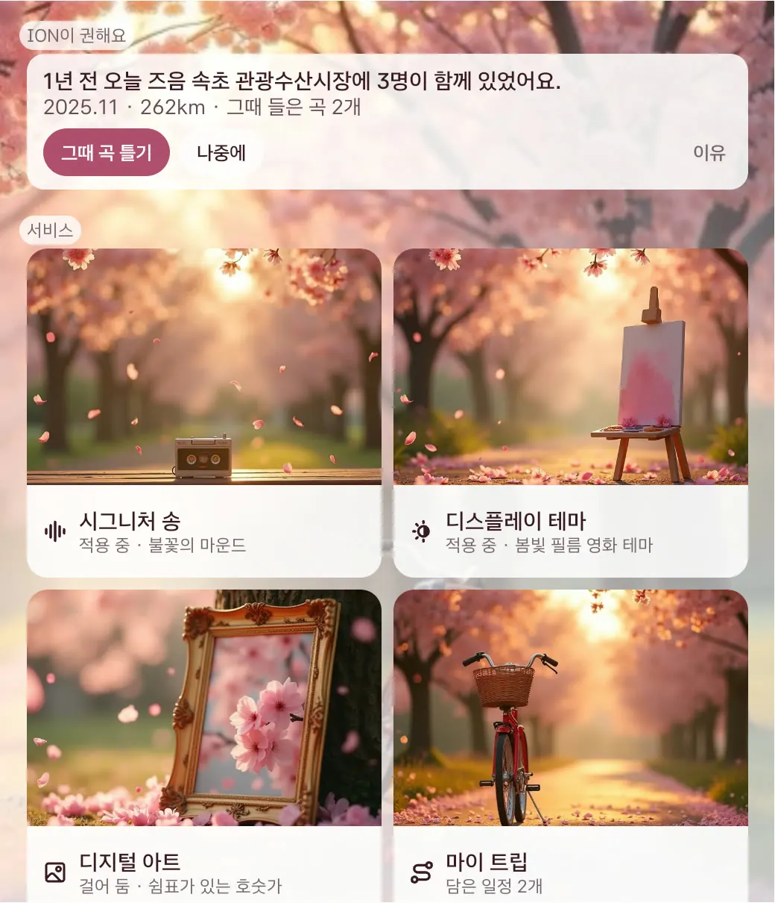 | 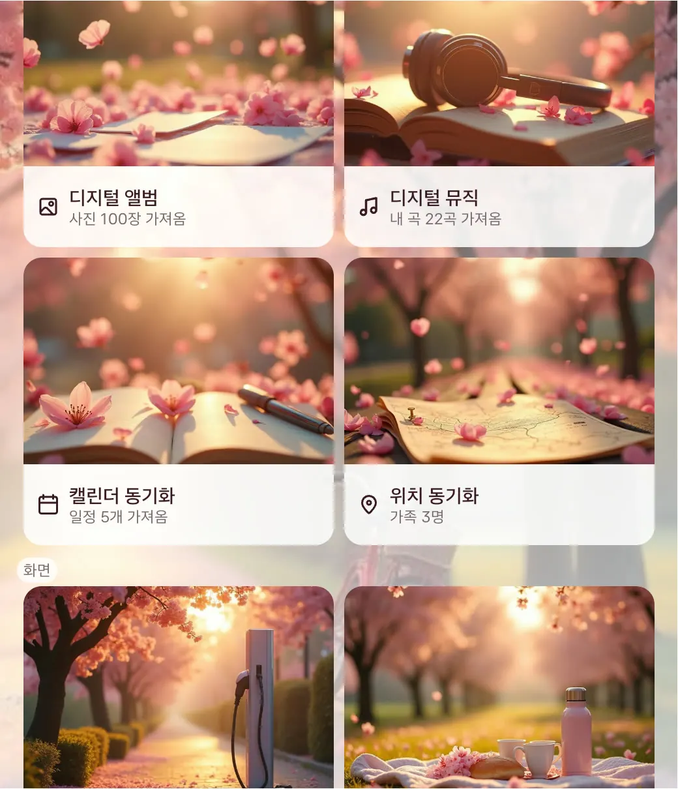 |

## 3. ION 칸: 말하기와 대화

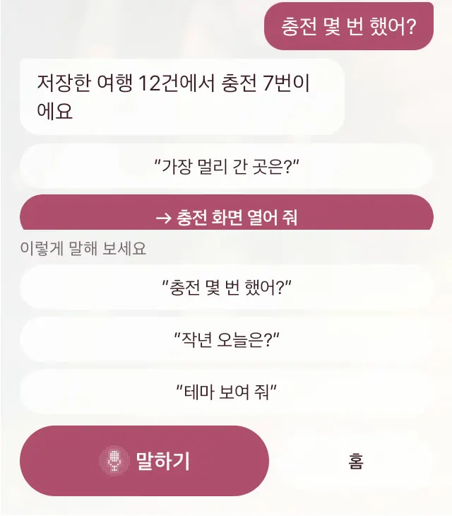

- **인사**: 시간대에 맞춰 이름을 부르고, 배터리 · 충전 · 날씨 · 가던 일정 · 그날의 기억 가운데 **값이 있는 것만** 말해요.
- **칩**: 상황에 맞는 말 3~4개가 7초마다 바뀌어요. 가장 급한 말(예: 다음 정류장 안내)은 늘 첫 줄이에요.
- **말하기**: 차의 음성 인식(SpeechToText, 온디바이스 ko-KR)이 받아 쓰고, 낱말 규칙이 ION의 일로 이어요. 마이크가 없는 기기에서는 칩을 눌러 대신해요.
- **답에서 화면으로**: 답 아래에 "→ 충전 화면 열어 줘" 같은 링크 칩이 붙어요.
- **한 턴 기억**: "거기 언제 갔어?" → 직전 답의 장소로, "그럼 올해는?" → 때만 바꿔 다시 물어요.
- **비교**: "지난달보다 많이 갔어?" · "여기 충전 평소보다 느려?"처럼 있는 값 둘을 나란히 견줘요.
- **주행 중**: 답의 첫 토막만 말하고 "서면 더 말할게요"를 붙여요. 화면 링크는 붙이지 않아요.
- **Gleo**: Gleo AI가 함수를 부르면 ION 칸에 "Gleo가 불렀어요"로 보여요.

> 기획서에서: [ION과 말하기: 모델 없이 규칙으로 답해요](https://prd.moonwave.kr/features#ion-talk) · [Gleo AI와 ION](https://prd.moonwave.kr/#gleo-vs-ion) · [기억에게 묻기](https://prd.moonwave.kr/brain#bf-ask) · [Gleo 음성 데이터](https://prd.moonwave.kr/data#gleo-voice)

## 4. 세 가지 모드

| 주행 | 도착(밤) |
|---|---|
| 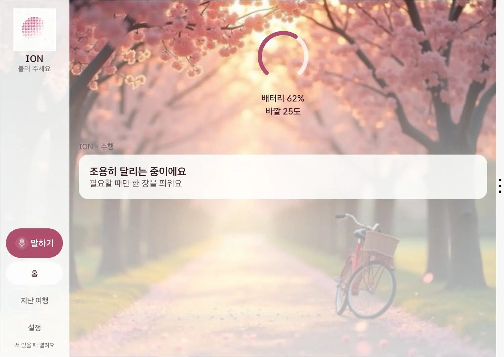 | 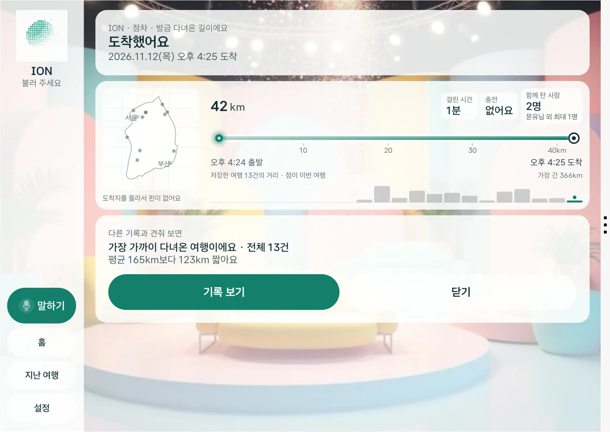 |

- **주행**: 카드 한 장과 단추 두 개뿐이에요. 입력이 없고 다른 화면은 열리지 않아요. 플랫폼의 주행 규제(`CarUxRestrictions`)가 "제한 필요"라고 하면 기어보다 먼저 이 모드로 가고, 글 길이 제한이 켜지면 카드 · 답을 그 길이에서 끊어요. 🚗
- **도착**: 서면 이번 여행의 요약(달린 거리 · 탄 사람 · 곡)을 보여 주고 이 기기에 기록해요. 📱
- **안전 카드**: 운전석 문이 열렸는데 뒷좌석에 사람이 있으면 알려요. 🚗

> 기획서에서: [주행 중 안전](https://prd.moonwave.kr/highend#driving-safety) · [차량 특화 요소](https://prd.moonwave.kr/features#vehicle-only)

## 5. 충전

| 충전 중 홈 | 충전 화면 | 충전 기록 |
|---|---|---|
| 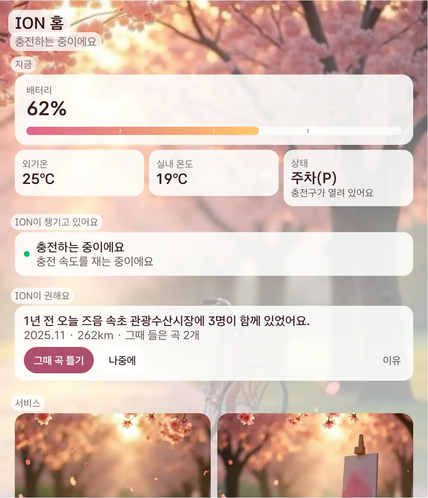 | 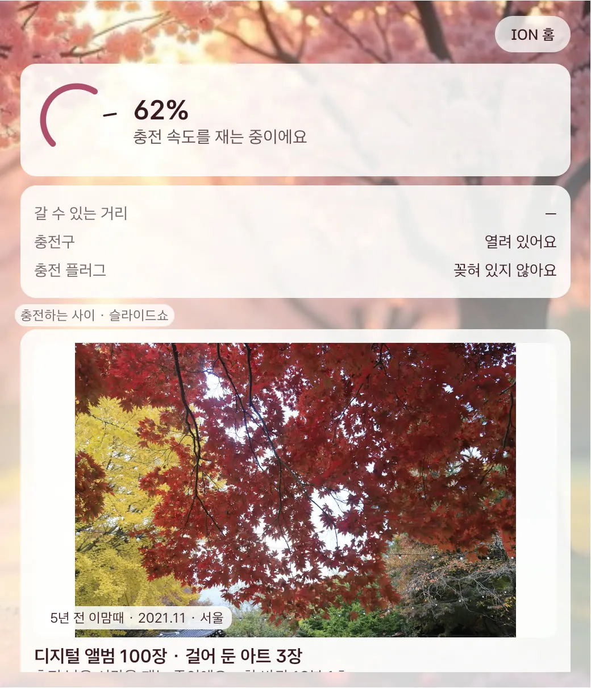 | 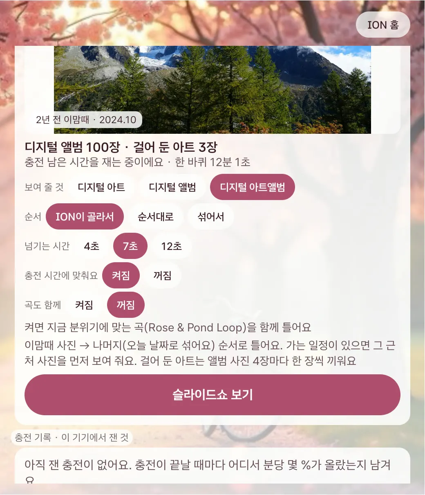 |

- 배터리 · 갈 수 있는 거리 · 충전구 · 플러그 🚗
- **남은 시간**: 차가 주지 않아서 배터리가 **오르는 속도를 직접 재어** 어림해요. 못 쟀으면 말하지 않아요. 📱
- **충전 기록**: 충전할 때마다 장소 · % · 분을 남겨 분당 %를 재요. 세 번 넘게 쟀으면 평소 속도와 견줘 "평소보다 느렸어요"라고 말해요. 📱

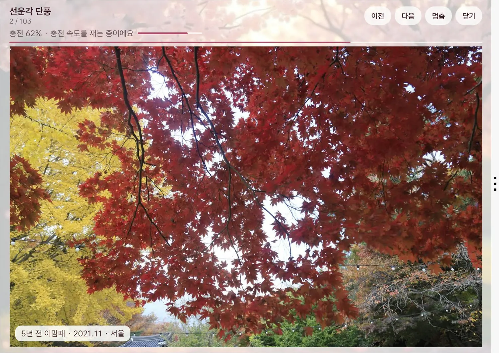

**충전하는 사이 · 슬라이드쇼**: 디지털 아트 · 디지털 앨범 · 둘 다 가운데 골라요. 80%까지 남은 시간을 쟀으면 그 시간에 맞춰 자르고, 위에 충전 상태 줄(배터리 · 남은 시간 · 80% 알림)을 띄워요. 밤에는 어둡게, 곡은 함께 틀 수 있어요(기본은 끔). 🚗 📱 🎬

> 기획서에서: 장면 [C · 충전하는 25분](https://prd.moonwave.kr/scenarios#scenario-c) · [마이현대에서 오는 서비스](https://prd.moonwave.kr/services#ion-myhyundai)

## 6. 서비스 여덟 가지

서비스마다 **내려받기(동기화) → 적용 → 쓰기 → 지우기**를 이 기기에서 실제로 해요. 결제는 없어요. 흐름은 기획서 [서비스 workflow](https://prd.moonwave.kr/services#svc-workflow), 확인한 범위는 [확인한 것과 확인 전인 것](https://prd.moonwave.kr/services#ion-check)에 있어요.

설정 › **ION Studio 연결**로 [ION Studio](https://ion-studio.moonwave.kr)와 이으면, 위 넷의 목록이 Studio에 지금 올라와 있는 것으로 바뀌어요([잇는 방법](https://prd.moonwave.kr/services#ion-connect) · [README](../README.md#ion-studio와-이어-보기)).

### ION Studio에서 오는 것

| 시그니처 송 | 디스플레이 테마 |
|---|---|
| 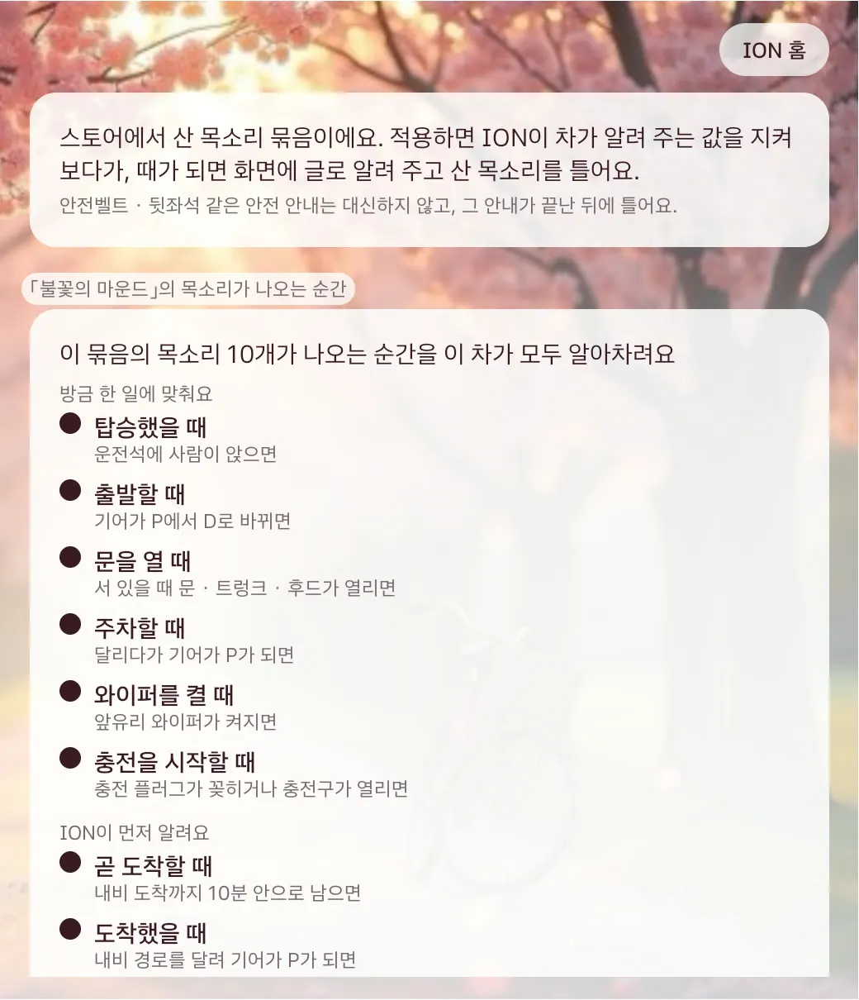 | 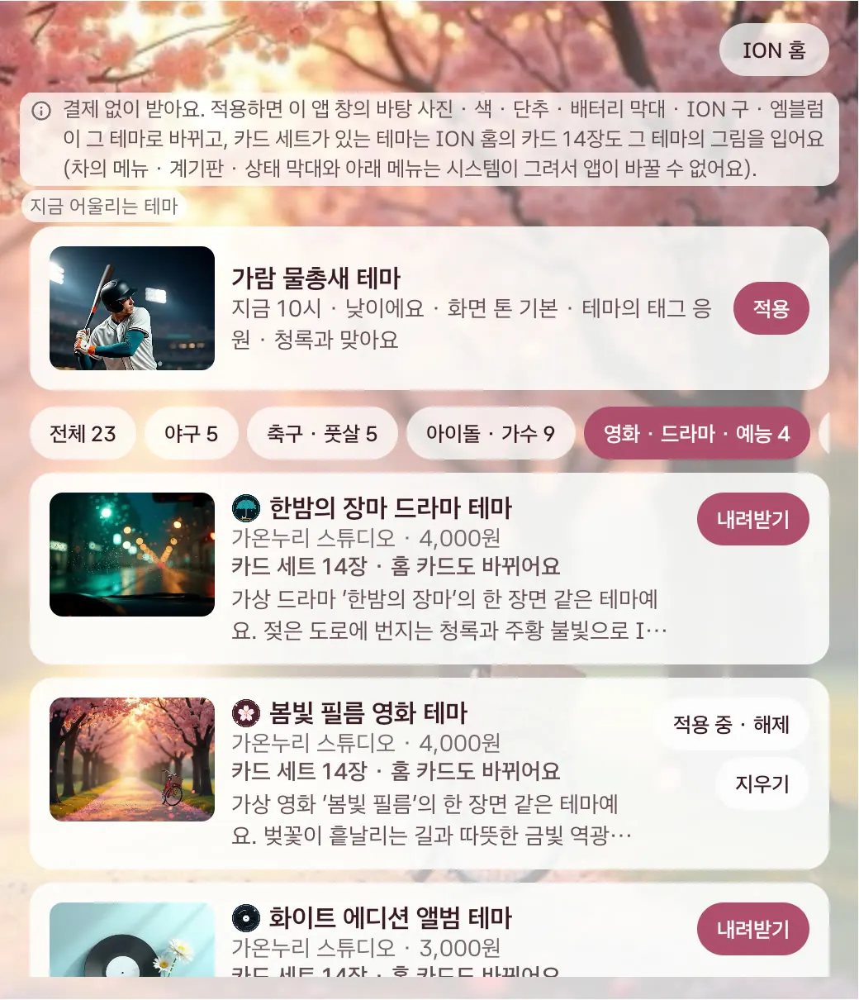 |

- **시그니처 송**: 선수 · 연예인의 **목소리 묶음**이에요. 적용하면 ION이 차의 값을 지켜보다가 그 순간에 글로 안내하고 목소리를 틀어요.
  - 작동시: 탑승 · 출발 · 문 열림 · 주차 · 와이퍼 · 공조 온도 · 충전 시작
  - 푸시형: 곧 도착 10분 · 도착 · 배터리 20% · 충전 80% · 2시간 운전 · 0℃ 이하
  - 같은 순간은 다시 나오지 않게 간격을 두고, **모르는 값은 조건도 모르는 것이라 아무것도 하지 않아요**. 안전 소리는 팩이 대신하지 않아요. 적용 전에 "들어 보기"로 한 토막을 들어 봐요. 🚗 🎬
  - 기획서 [시그니처 송](https://prd.moonwave.kr/ion-studio#ion-song) · 장면 [G · 응원하는 선수와 출근길](https://prd.moonwave.kr/scenarios#scenario-g) · ION Studio [스토어](https://ion-studio.moonwave.kr/#/store)
- **디스플레이 테마**: 23개, 갈래(야구 · 축구 · 아이돌 · 가수 · 영화 · 드라마 · 예능)로 골라요. 적용하면 창 바탕(낮 · 밤) · 색 · 반투명 카드 · 단추 · ION 구 · 홈 카드 14장이 바뀌어요. 차의 메뉴 · 계기판 · 아래 막대는 시스템이라 바꾸지 않아요. 🎬
  - 기획서 [ION Studio에서 오는 서비스](https://prd.moonwave.kr/services#ion-svc-studio) · 장면 [F · 창작자의 한 달](https://prd.moonwave.kr/scenarios#scenario-f) · ION Studio [스토어](https://ion-studio.moonwave.kr/#/store)

| 디지털 아트 | 마이 트립 |
|---|---|
| 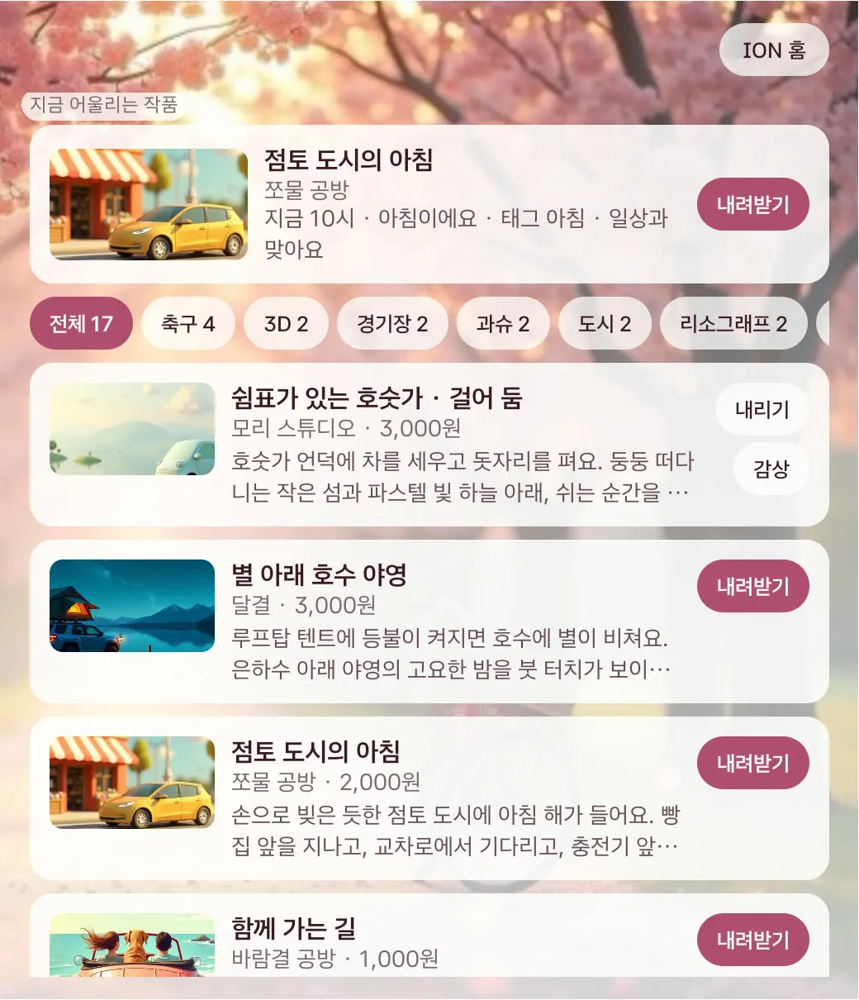 | 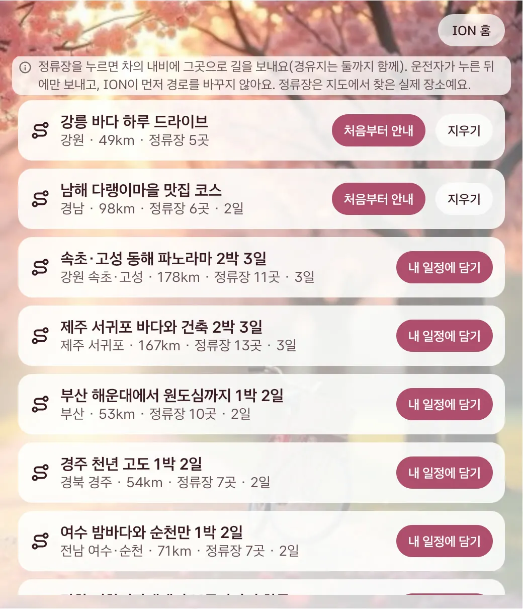 |

- **디지털 아트**: 작품을 "걸기"하면 ION 칸과 충전 화면에 걸려요. 시간대 · 갈래에 맞는 순서로 보여요. 🎬
  - 기획서 [디지털 아트](https://prd.moonwave.kr/ion-studio#ion-art) · ION Studio [작가 소개](https://ion-studio.moonwave.kr/#/creators)
- **마이 트립**: 정류장마다 **여기로 안내** → 내비가 경로를 열고 다음 두 정류장은 경유지로 넣어요. 내비가 경유지 · 목적지 도착을 알려 주면 "도착했어요 · 다음 정류장"으로 넘어가요. 내비 알림이 없을 때를 위해 손으로 넘기는 단추도 있어요. 🚗 🎬
  - 기획서 [마이 트립](https://prd.moonwave.kr/services#ion-trip) · [마이 트립 일정 · 지도와 전기차 정보](https://prd.moonwave.kr/ion-studio#ion-trip-ev) · 장면 [H](https://prd.moonwave.kr/scenarios#scenario-h) · ION Studio [여행 일정](https://ion-studio.moonwave.kr/#/store?tab=trips)

### 마이현대에서 오는 것

| 디지털 앨범 | 디지털 뮤직 |
|---|---|
| 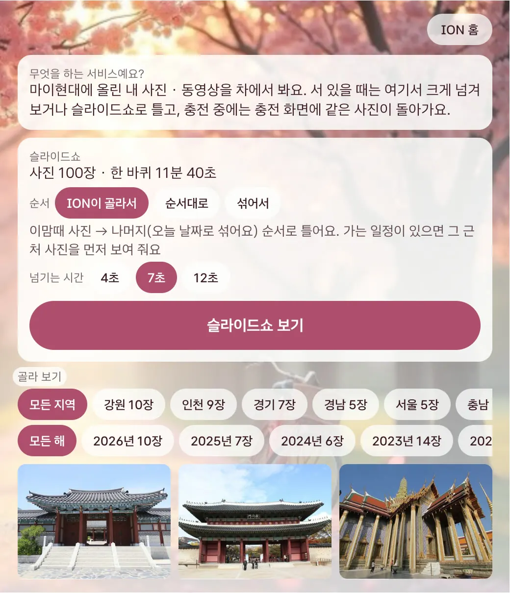 | 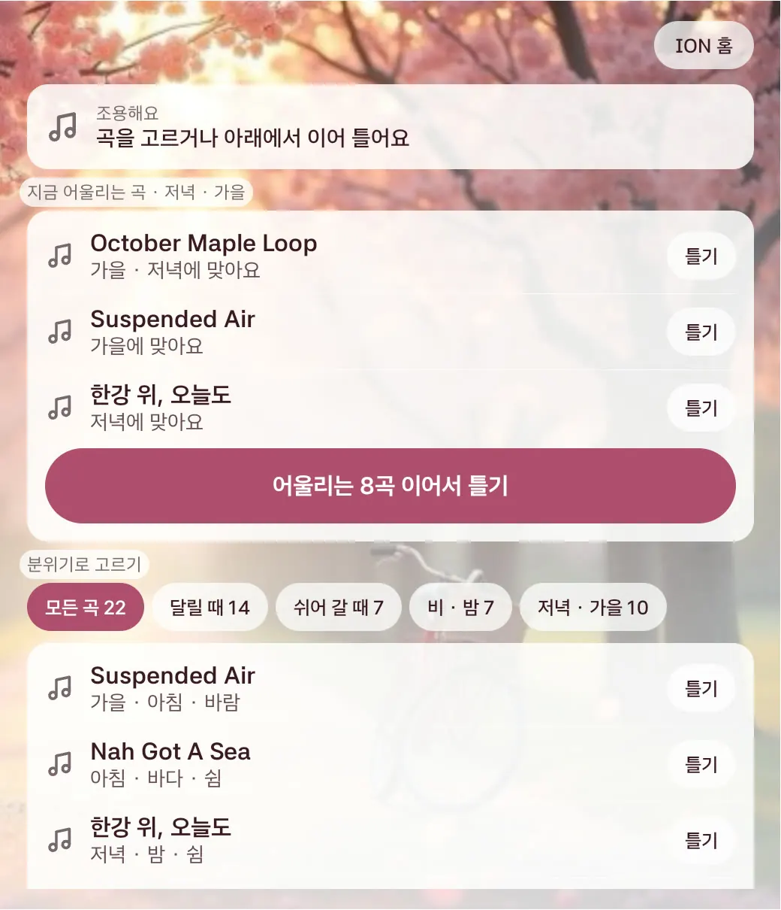 |

- **디지털 앨범**: 마이현대에 올린 사진을 차에서 보는 것이에요. 지역 · 해 · 여행을 다녀온 달로 묶고, 누르면 앱 창 가득 넘겨 보고(좌우 밀기 · 이전 · 다음), 슬라이드쇼로 틀어요. 🎬
- **디지털 뮤직**: 지금 어울리는 순서 · 분위기 묶음 · 여행과 이어진 곡. 이전 · 다음 · 멈추기, MediaSession으로 차의 미디어 키에도 반응해요. 🎬
- 기획서 [마이현대에서 오는 서비스](https://prd.moonwave.kr/services#ion-myhyundai) · 장면 [C](https://prd.moonwave.kr/scenarios#scenario-c)

| 캘린더 동기화 | 위치 동기화 |
|---|---|
| 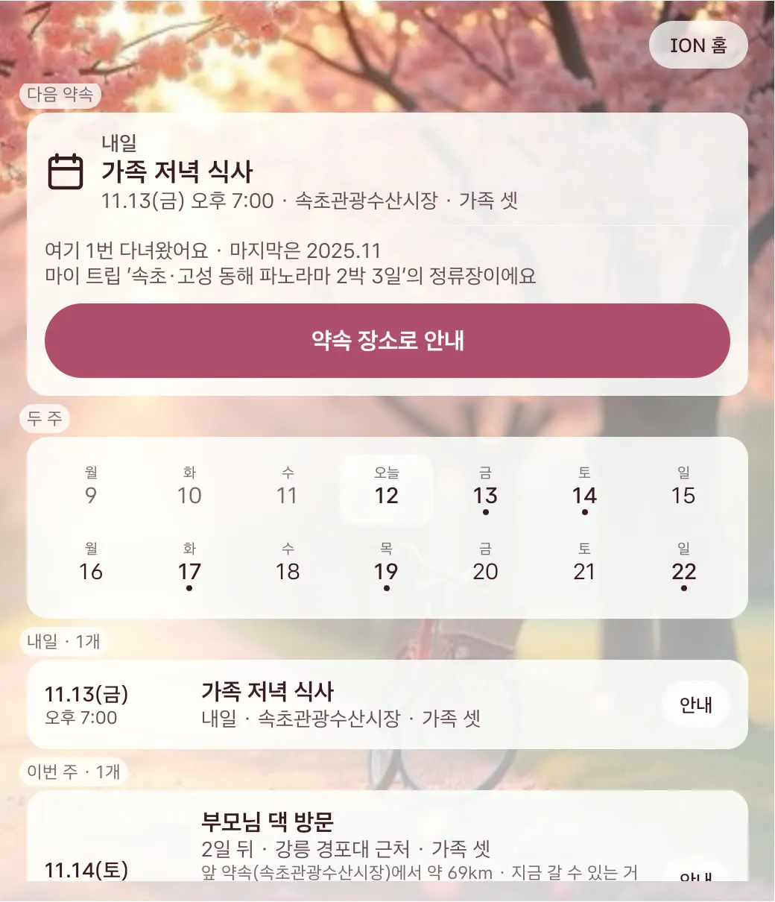 | 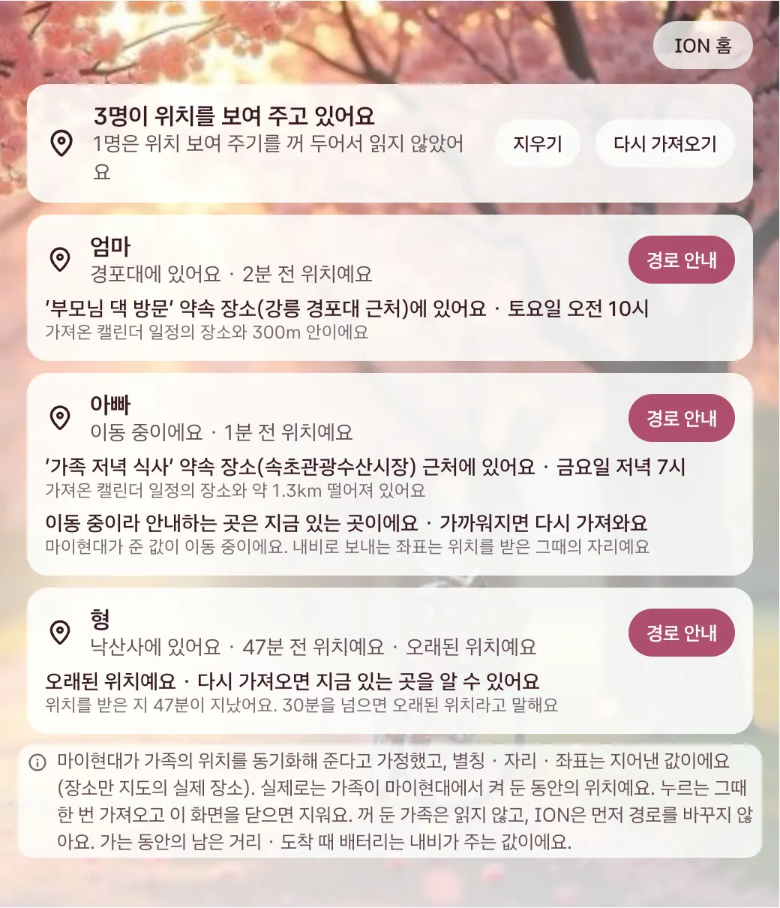 |

- **캘린더 동기화**: 다음 약속 카드 → 두 주 띠 → 묶음 목록. 가는 중이면 **내비의 남은 시간으로 약속 시각과 견줘** 늦을지 말해요. 좌표가 있는 약속은 "약속 장소로 안내". 🚗 🎬 · 장면 [D · 금요일 저녁 가족 식사](https://prd.moonwave.kr/scenarios#scenario-d)
- **위치 동기화**: 마이현대가 가족 위치를 준다고 가정한 값으로, 별칭 · 자리 · ION의 한마디 · **경로 안내**를 해요. 🎬 · 기획서 [위치 동기화](https://prd.moonwave.kr/services#ion-location) · 장면 [E · 엄마가 있는 곳으로](https://prd.moonwave.kr/scenarios#scenario-e)

## 7. 화면 여섯 가지

| 점검 | 여행 기록 | 설정 |
|---|---|---|
| 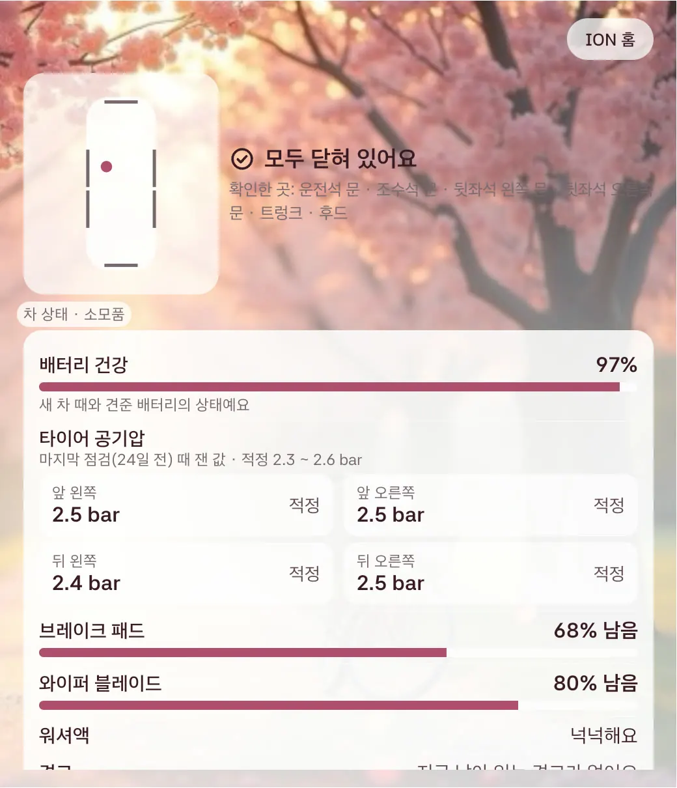 | 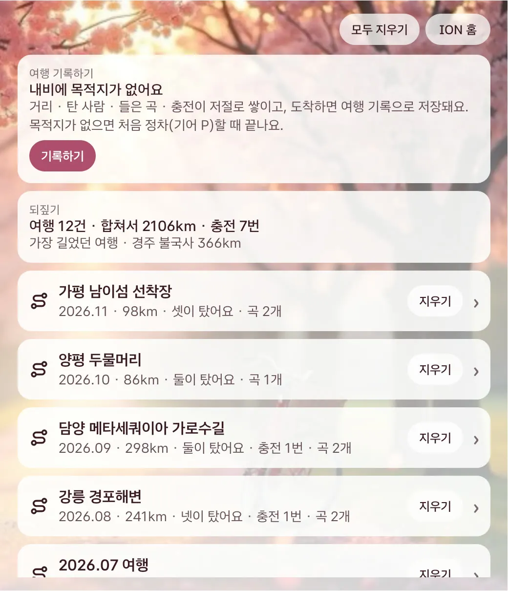 | 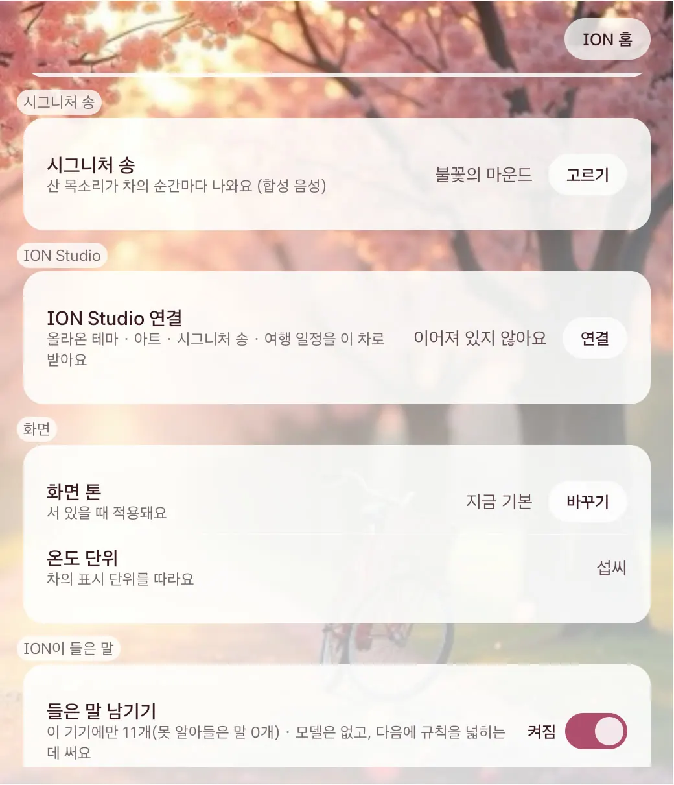 |

- **가족 · 자리**: 네 자리의 탑승 · 안전벨트. 운전석에 사람이 있을 때만 "문유님 외 2명이 탔어요"처럼 이름으로 말해요. 🚗
- **점검**: 위는 차가 지금 주는 값(위에서 본 차 · 문 · 트렁크 · 후드) 🚗, 아래는 서비스센터 기록(배터리 건강 · 타이어 공기압 · 소모품 · 다음 점검 · 정비 이력) 🎬. 맨 아래 한 줄이 무엇을 차에서 직접 읽었는지 밝혀요.
- **여행 기록**: 도착하면 이 기기(SQLite)에 쌓고, 다음에 같은 곳으로 가면 "이 길, 1년 전에 셋이 달렸어요"처럼 알려 줘요. **기록하기**로 내비 목적지부터 시작해 달린 거리 · 탄 사람 · 곡 · 충전을 쌓아요. 줄을 누르면 걸린 시간 · 순위 · 같은 곳 · 그때 곡 · 다시 안내가 있는 세부 화면이 열려요. 📱 🎬 · 기획서 [기억](https://prd.moonwave.kr/services#ion-road)
- **ION이 닿는 데이터**: ION의 기능 30개 가운데 이 앱이 만들 수 있는 것(● 만들 수 있어요 · ◐ 일부만 · ○ 이 앱만으로는 못 해요)과 그 까닭을 ION-Link 그래프로 보여 줘요. 📱 · 기획서 [ION이 할 수 있는 일](https://prd.moonwave.kr/features#ion-can) · [아는 쪽: ION-Link](https://prd.moonwave.kr/brain#brain-ontology)
- **설정**: 음성 안내 · 충전 화면 자동 · 화면 톤(와이퍼 · 등 · 김서림 신호로 짐작한 선명 · 기본 · 차분) · 시그니처 송 · ION이 들은 말(남기기 · 내보내기 · 지우기) · ION Studio 연결. 설정마다 한 줄이에요. · 기획서 [설정](https://prd.moonwave.kr/services#ion-settings) · [화면 톤](https://prd.moonwave.kr/features#tone) · 장면 [B · 비 오는 날의 퇴근길](https://prd.moonwave.kr/scenarios#scenario-b)

## 8. 테마 카드 세트

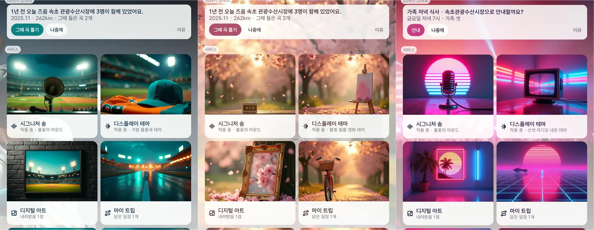

같은 ION 홈이 테마 셋(가람 물총새 · 봄빛 필름 · 선셋 라디오)을 입은 모습이에요. 그림에는 사람 · 글자 · 로고가 없고, 실제 차종처럼 보이는 차를 그리지 않았어요. 같은 테마가 ION Studio [스토어](https://ion-studio.moonwave.kr/#/store)에 있어요.

## 9. ION 디스플레이

ION은 캐릭터나 얼굴이 없어요. 흰 바탕에 **17 × 17 도트 구**가 회색에서 검정까지 다섯 단계로 숨 쉬어요.
- 듣는 중에는 구가 가운데로 오고 목소리가 클수록 물결이 세져요. 생각 중에는 밝기가 구를 따라 돌아요.
- 가끔 시동이 켜지듯 도트가 꺼졌다가 차례로 켜져요.
- 크기는 황금비 사다리(55 · 89 · 144 · 233 · 377dp)에서 골라요.
- 기기에서 애니메이션을 끄면 모두 멈춰요.

> 기획서에서: [ION은 누구인가](https://prd.moonwave.kr/#ion) · [사람마다 달라지는 ION](https://prd.moonwave.kr/highend#ion-grows)
